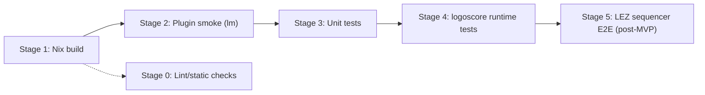

# CI Plan — `logos-agent-module` (DRAFT, awaiting approval)

Repo: https://github.com/gsimsekfb/logos-agent-module · CI platform: **GitHub Actions** (assumed)

## 1. Where we are (as of commit `68d38d8`)

| Task | State | What CI can use from it |
|---|---|---|
| 1.3 Module skeleton | ✅ | `nix build` → `result/lib/agent_module_plugin.so` (flake on `logos-module-builder`) |
| 1.4 Identity (Ed25519, OpenSSL) | ✅ | Pure logic: `toHex`, `saveIdentity`/`loadIdentity` (hand-rolled JSON parser — fragile) |
| 1.5 Owner channel (LpClient → chat_module) | ✅ | Integration-only (needs chat_module); fallback paths testable |
| 1.6 First skills (`echo`, `meta.status`, `wallet.balance`) | ✅ committed (task list not ticked yet) | Manual tests run with `lm` + `logoscore` (see `logoscore-cheatsheet.md`, `notes-1.6`) |
| Unit tests | ❌ none | `tests.md` already listed what is worth testing |
| CI | ❌ none (`.github/` missing) | — |

**Spec requirements (LP-0008, lines 125–130) that drive CI:**
- E2E integration tests against a **LEZ sequencer (standalone mode)** must be **in CI**.
- **CI must be green on the default branch.**
- Reproducible demo script with `RISC0_DEV_MODE=0` (evaluators run from a clean env) → CI should at least prove the script runs (in dev mode).

## 2. Proposed CI stages (incremental — each stage is a separate PR)

### Stage 0 — Cheap checks (optional, fast, run in parallel)
- `metadata.json` / `manifest.json` valid JSON + **name/version consistency** between them (we hit the "only manifest.json loads" issue in 1.6).
- `nix flake check` (flake evaluates).
- Optional: `clang-format --dry-run` (needs a `.clang-format` first — decide later).

### Stage 1 — Reproducible build ⭐ MVP
> Status: install + build steps added in `.github/workflows/ci.yml` (no cache/artifact yet) — not yet run/verified.

- Install Nix (`cachix/install-nix-action` / `DeterminateSystems/nix-installer-action`) + Nix cache (`magic-nix-cache` or Cachix) — first build is heavy (Qt/Boost/logos-module-builder).
- `nix build` → assert `result/lib/agent_module_plugin.so` exists.
- Upload `.so` + `manifest.json` as a build artifact (loadable asset, also useful for the spec's "loadable assets provided").
- Triggers: push to `main`, PRs.

### Stage 2 — Plugin introspection smoke test ⭐ MVP
- Inside `nix develop`: run `lm result/lib/agent_module_plugin.so`.
- Assert the expected methods/events are exported (e.g. `getStatus`, `getIdentity`, `setupOwnerChannel`, `sendToOwner`, `listSkills`, `executeSkill`, `skillCompleted` …) — catches broken codegen/glue.

### Stage 3 — Unit tests (needs code work) ⭐ MVP
- Per `tests.md`: extract pure logic (hex, identity JSON load/save, command routing, skill dispatch) into a Logos-header-free unit **or** link the impl into a test target.
- Framework: GoogleTest or Qt Test (decide), wired via CTest; build a test derivation / run in `nix develop`.
- Targets: `toHex`, identity round-trip + corrupt/missing file, `processOwnerCommand` routing, `executeSkill` (known/unknown skill, `wallet.balance` "unavailable" fallback).

### Stage 4 — Runtime tests with `logoscore` ⭐ MVP (stretch)
> Status: `tests/smoke_logoscore.sh` + "Install logoscore" (release v0.2.2 tarball → `logoscore-x86_64.AppImage`) / "Runtime smoke test" steps added to `build.yml` — not yet run/verified.
- Script `tests/smoke_logoscore.sh` (turn the 1.6 manual test into a committed script): start `logoscore daemon -m <tmp>/modules`, `load-module agent_module`, call `listSkills`, `getStatus`, `executeSkill meta.status|wallet.balance|echo|nope`, assert JSON with `jq`, check `meta.status` returns < ~5s (regression for the 20s-timeout/segfault bug).
- ⚠️ Need `logoscore` reproducibly in CI (currently from `~/.local/bin`) → ideally a flake input / devShell package.

### Stage 5 — LEZ sequencer E2E (post-MVP, spec-mandated)
- Spin up standalone LEZ sequencer (`RISC0_DEV_MODE=1`, pinned commit) in CI (Docker or nix), plus wallet/chat modules.
- Run wallet/messaging skill E2E flows; later run the demo script.
- `RISC0_DEV_MODE=0` real proofs: **manual/nightly only** (too heavy for GH runners; 16 GB swap was needed locally).

## 3. Cross-cutting items
- Branch protection on `main`: require Stage 1–3 (later 4–5) checks → satisfies "CI green on default branch".
- Pin inputs: `flake.lock` committed ✅; pin LEZ sequencer commit for Stage 5.
- CI badge in README (README doesn't exist yet — add one).
- Timeouts per job; cache to keep PR runs reasonable.

## 4. Proposed order of work
1. Stage 0 + 1 (one workflow `ci.yml`) → verify green on GitHub.
2. Stage 2.
3. Stage 3 (code refactor + tests).
4. Stage 4 (after deciding how to get `logoscore` into CI).
5. Stage 5 with Phase 2/3 work.

## 5. Open questions for approval
1. GitHub Actions OK? Any Nix cache preference (free `magic-nix-cache` vs Cachix account)?
2. Scope for now: Stages **0–2 only**, or also **3 (unit tests)** in this round?
3. Test framework: GoogleTest vs Qt Test?
4. `logoscore` for Stage 4: where does your `~/.local/bin/logoscore` come from (which repo/flake)?
5. Add `.clang-format` + format check, or skip?

## 6. Manual verification (once implemented)
- Push a branch / open a PR → check Actions tab, all jobs green, artifact downloadable.
- Locally reproduce each job: `nix build`, `nix develop -c lm result/lib/agent_module_plugin.so`, `ctest --test-dir build`, `bash tests/smoke_logoscore.sh`.
- Break something on purpose (e.g. rename a method) → confirm Stage 2/3 goes red.

